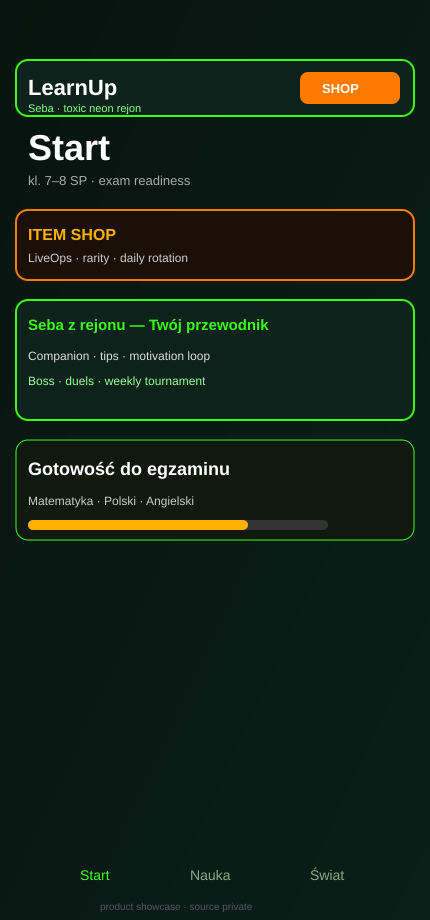
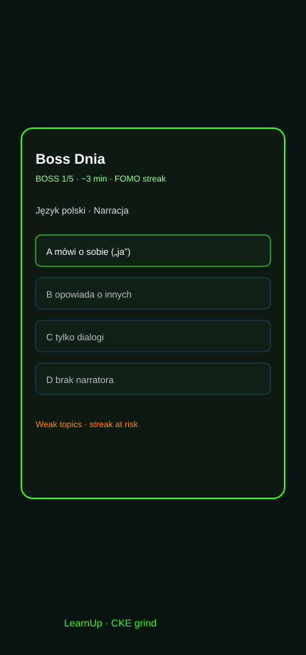
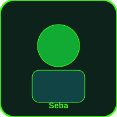

# LearnUp

### Gamified exam prep for Polish grades 7–8 — product showcase (source private)

[](#)
[](#)
[](#)
[](#source-code-policy)
[](#)

> **Employer / recruiter note:** this repository is a **public product brief**.  
> Implementation, question banks, economy balancing and live ops configs stay in a **private** codebase.  
> Ask for a walkthrough or private code review under NDA.

<p align="center">
  
  &nbsp;
  
</p>

<p align="center">
  
</p>

---

## What it is

**LearnUp** is a full learning product (not a demo quiz) that wraps **CKE-style exam practice** (math / Polish / English) in a **game loop kids actually open again**:

- neon “rejon” aesthetic + companion guide **Seba**
- economy, rarity shop, seasonal LiveOps
- social unlocks, duels, weekly tournament
- readiness meter that grows from **learning**, not cosmetics

Built as a **cross-platform Python client** (desktop + browser) with persistent local state.

---

## Why this is a “big” build

| Layer | What shipped (high level) |
| --- | --- |
| **Learning core** | Multi-subject quiz engine, mistake memory, boss fights, exam readiness |
| **Motivation systems** | Streaks, FOMO nudges, ranks, parent praise hooks, class energy |
| **Live economy** | Soft currency, rarity tiers, daily shop rotation, limited holiday drops |
| **Social loop** | Invite codes, learn-to-unlock, 1v1 duels, weekly tournament (everyone gets something) |
| **Catalogs** | Learning modes, contracts/seasons, boosts, in-app help |
| **Companion UX** | Seba sprite states, tips, optional local LLM chat |
| **Delivery** | One codebase → desktop window + web share via tunnel |

Rough scale of the private app: **8k+ LOC** product UI/logic in a single maintainable Flet surface, with SQLite persistence and asset pipeline for companion art.

---

## Product map (no internals)

```mermaid
flowchart TB
  subgraph Player
    A[Home / readiness]
    B[Learn modes]
    C[Boss of the Day]
    D[World / cinematic]
  end
  subgraph Motivation
    E[Streak + FOMO]
    F[Shop + LiveOps]
    G[Duels + Tournament]
    H[Seba companion]
  end
  subgraph Outcomes
    I[Exam readiness ↑]
    J[Social proof / invites]
  end
  A --> B --> C
  A --> D
  B --> I
  C --> E
  F --> B
  G --> J
  H --> E
  E → A
```

---

## Feature highlights

### Learning that feels like a game
- **Bitwa / quiz flows** styled for CKE ABCD energy  
- **Boss of the Day** — short high-stakes set from weak topics  
- **Exam readiness** per subject (math / Polish / English)  
- Boosts & contracts that buy *advantage in learning*, not empty skins

### LiveOps & shop
- Always-on item shop with **rarity** framing (CS / Fortnite mental model)  
- **24h daily rotation** + **LIMITED** holiday events (e.g. Halloween / national days)  
- Seasonal currency flavours (event coins)

### Social without kid-casino vibes
- Progress **unlocks** social features  
- Friend **invites**  
- **Duels** with system-topped prize pool  
- **Weekly tournament** where participation still pays something

### World & companion
- “Twój świat” cinematic layer beyond icons  
- **Seba** — tone, tips, wardrobe/light variants, optional chat

---

## Tech (public)

| Area | Choice |
| --- | --- |
| UI / runtime | [Flet](https://flet.dev) (Flutter-backed) — Python UI for web + desktop |
| Language | Python 3.10+ |
| Persistence | SQLite |
| Distribution | Local desktop launcher + web host + Cloudflare quick tunnel for demos |
| Art | Custom companion sprites / cards |

Exact module layout, prompts, bank authorship and balancing tables are **not** published here.

---

## Source code policy

- **This repo:** README, screenshots, brand stills, architecture sketch.  
- **Not in this repo:** application source, databases, private question IP, keys.  
- Private development continues elsewhere; public surface is updated when product milestones land.

If you are hiring and want depth: I’m happy to do a **live demo** or a **guided private review**.

---

## Status

🚧 **Active build** — core loops playable; LiveOps, social, catalogs and readiness systems iterating weekly.

---

## Author

**[@marfilip748](https://github.com/marfilip748)**  
Building LearnUp — gamified exam prep (Python / Flet).

---

### PL (krótko)

**LearnUp** to pełna gra-nauka pod egzamin 8-klasisty: bank CKE-style, boss dnia, gotowość przedmiotowa, sklep LiveOps, duels/turniej i companion Seba.  
To repo to **publiczna wizytówka produktu** — kod źródłowy zostaje prywatny, żeby pracodawca widział skalę i jakość, bez wycieku implementacji.
