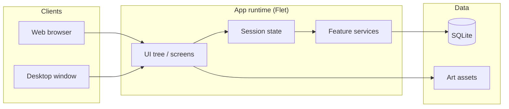

# Architecture (public sketch)

High-level only — enough for technical interview conversation, not a rebuild guide.

## Domains (names only)

| Domain | Responsibility |
| --- | --- |
| Learn | Quiz / boss / readiness / catalogs |
| Economy | Currency, shop rotation, LiveOps windows |
| Social | Invites, duels, weekly tournament |
| Companion | Seba presentation + tips (+ optional LLM) |
| Shell | Nav, theme, onboarding, share/web host |

No schemas, endpoints, or algorithms are published here.
